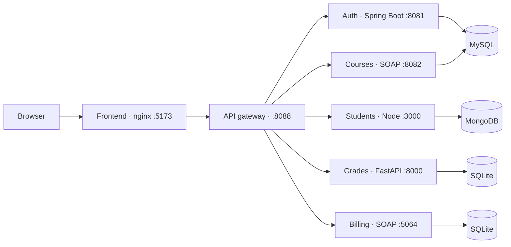
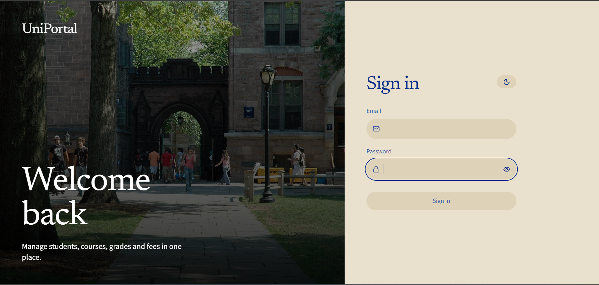
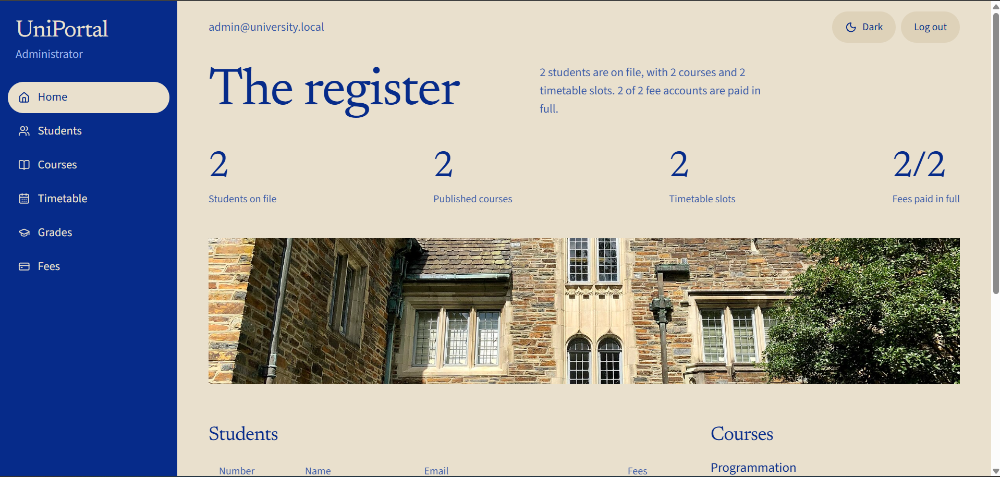
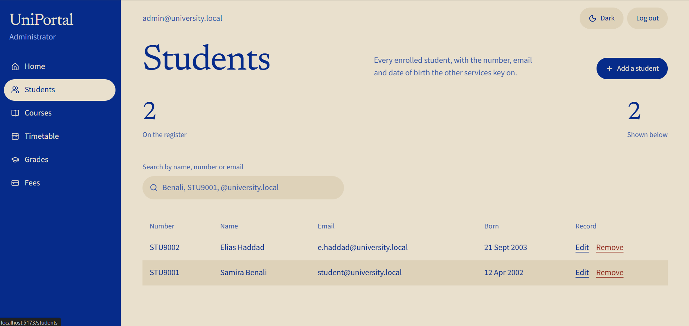
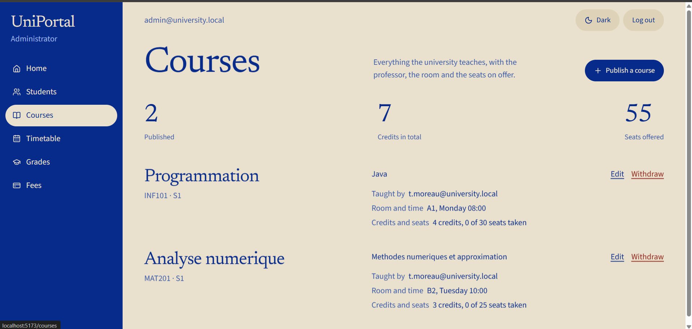
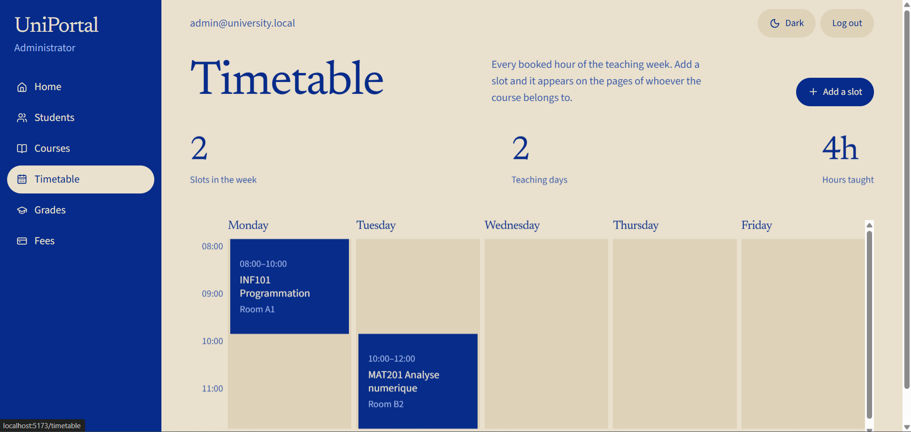
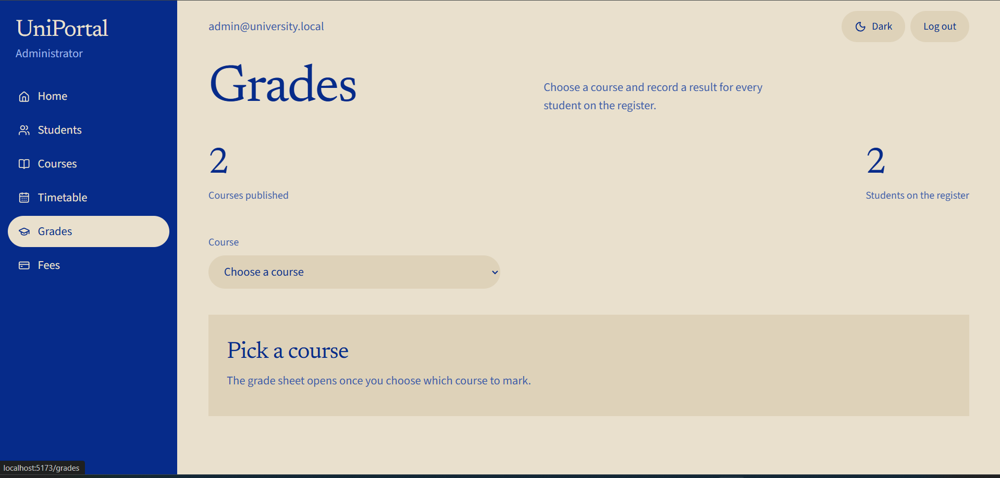
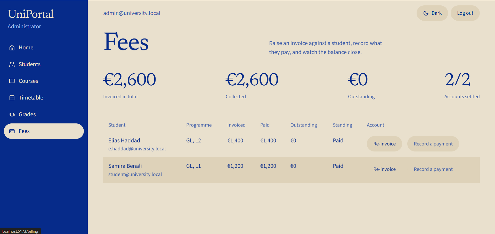

# UniPortal

[](https://github.com/RaedTN/university-microservices/actions/workflows/ci.yml)

UniPortal is a university portal built as a team project. I took that codebase, fixed it, secured it, Dockerized it, and extended it with a role-aware web interface. One gateway is the only public API. The browser talks to one origin.

## Architecture



The frontend container proxies `/auth`, `/students`, `/grades`, `/rest`, `/health`, `/courses`, and `/billing` to the gateway. Page loads on those paths still return the React app. Direct service ports stay inside the Compose network. MySQL is also published on `localhost:3307` and MongoDB on `localhost:27018` for inspection.

## Tech stack

| Service | Folder | Stack | Data |
| --- | --- | --- | --- |
| Frontend | `frontend` | React 19, TypeScript, Vite, Tailwind 4, nginx | — |
| API gateway | `api-gateway` | Java 17, Spring WebFlux | — |
| Auth | `auth-service` | Java 17, Spring Boot, Spring Security, JWT | MySQL `authdb` |
| Students | `Service-Etudiant1` | Node.js, Express | MongoDB `students` |
| Grades | `Grade-Service` | Python, FastAPI | SQLite |
| Courses | `course-service/course-service` | Java 11, JAX-WS SOAP, exposed as REST by the gateway | MySQL `university_db` |
| Billing | `billing-service` | .NET 8, WCF SOAP, exposed as REST by the gateway | SQLite |

Roles are `ADMIN`, `ENSEIGNANT`, and `ETUDIANT`. The gateway checks the JWT and forwards the caller’s email and role. A student can read only their own record, grades, and invoices.

## Features by role

**Administrator**

- Home overview of students, courses, timetable slots, and fee accounts
- Create, edit, and delete students
- Publish, edit, and withdraw courses
- Add and edit timetable slots on a weekly grid
- Record, update, and withdraw grades for a course
- Create invoices and record payments

**Teacher**

- Read the student register
- See the courses assigned to their account, and the matching timetable
- Enter and edit grades for those courses
- Fees are not available

**Student**

- Home page with their record, grade average, and fee balance
- Courses and timetable slots for the courses that have a grade on their email
- Their own grades and average
- Their own invoice and balance

There is no enrollment record yet. A student’s courses are the courses that already have a grade for them.

## Screenshots

| Sign in | Home |
| --- | --- |
|  |  |

| Students | Courses |
| --- | --- |
|  |  |

| Timetable | Grades |
| --- | --- |
|  |  |



## Quick start

Docker and a copy of the environment file are enough.

```powershell
copy .env.example .env
docker compose up --build
```

Open http://localhost:5173.

`.env.example` contains placeholders only. Set your own `JWT_SECRET` before you use the stack anywhere other than your machine. The same value must be shared by every service. `.env` is gitignored.

`GET http://localhost:8088/health` still reaches the gateway directly and should return `{"status":"UP","service":"API Gateway"}`.

For a service-by-service run without Docker, see [RUN.md](RUN.md). For frontend work with hot reload, stop the frontend container and run `npm run dev` in `frontend`. The dev server uses the same host port, 5173.

## Demo accounts

These accounts are for a local demo. They are not real people. Change the passwords before the stack is reachable by anyone else.

| Role | Email | Password | Where it comes from |
| --- | --- | --- | --- |
| Administrator | `admin@university.local` | `change-me` | Created on first auth startup from `ADMIN_EMAIL` and `ADMIN_PASSWORD` in `.env` |
| Teacher | `teacher@university.local` | `password123` | Postman request **Create Teacher** |
| Student | `student@university.local` | `password123` | Postman request **Register Student** |

The administrator password in the table matches `.env.example`. If you change `.env`, use that password instead. The teacher and student rows are the sample bodies in the Postman collection, not accounts that Compose creates by itself.

## API testing

Import both files into Postman:

- `SOA-Project-Postman-Collection.json` — 23 requests
- `SOA-Project-Postman-Environment.json` — base URL `http://localhost:8088`, empty token variables

Select the environment **SOA Project Environment**. Login requests store the JWT. The collection is grouped as:

| Group | Requests |
| --- | --- |
| Health and gateway info | 2 |
| Auth | 5 |
| Students | 4 |
| Grades | 2 |
| Courses and timetable | 4 |
| Billing | 4 |
| SOAP WSDL | 2 |

Run health, then login, then the protected calls. A protected call with an empty token returns 401.

## Next improvements

- An enrollment model, so a student can be on a course before a grade exists
- One grades-by-course endpoint and one billing list endpoint, so staff pages do not call the API once per student
- Token refresh and a shorter JWT lifetime
